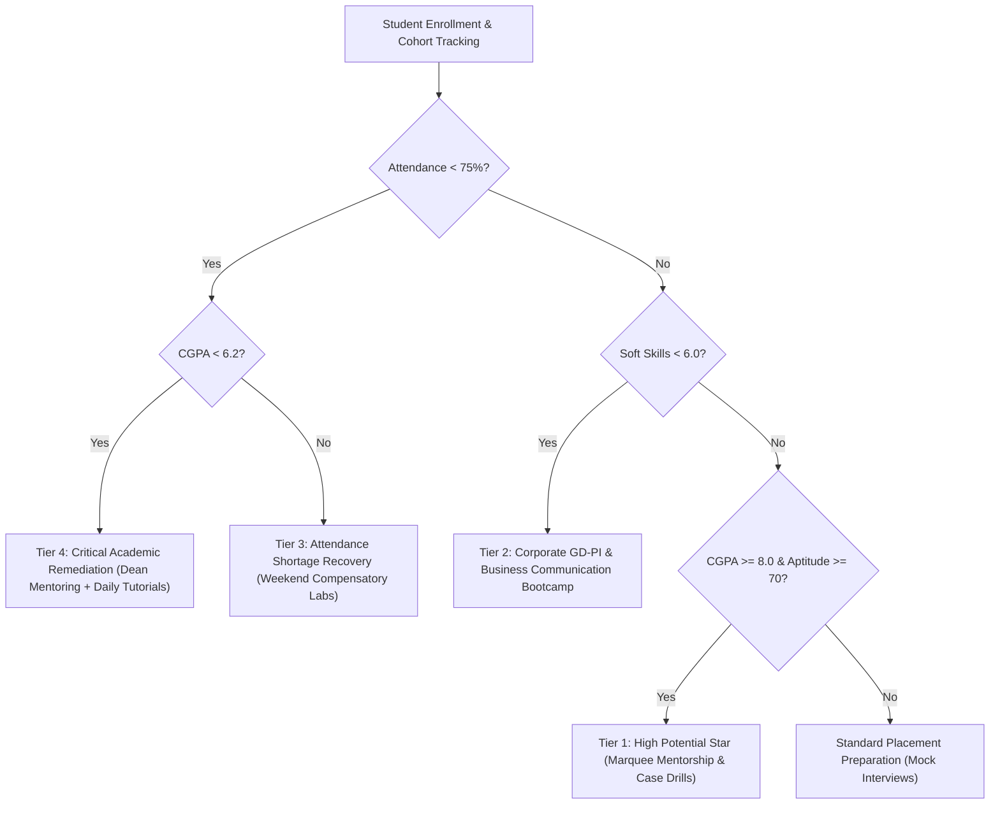

# CHANDIGARH UNIVERSITY
## Department of Business Studies & Analytics
### Master of Business Administration (MBA) Major Capstone Project Report

---

# STUDENT PERFORMANCE & PLACEMENT ANALYTICS
### *An Econometric & Prescriptive Decision-Support Framework for Higher Education Institutions*

**Academic Year:** 2024 – 2025  
**Course Code:** MBA Analytics Capstone  
**Institution:** Chandigarh University, Mohali, Punjab  

---

## EXECUTIVE SUMMARY

Placement outcomes represent the quintessential operational benchmark of MBA programs. Despite substantial institutional investment in placement cells and corporate relations, business school administrators routinely struggle with information asymmetry: they lack granular, empirical visibility into how continuous academic performance, classroom attendance rigor, and specialization selection interact to determine campus hiring compensation (CTC).

This project develops an end-to-end **Student Performance & Placement Analytics System** for an MBA cohort of **520 students** across five strategic disciplines: **Business Analytics, Finance, Marketing, Human Resource Management, and Operations & Supply Chain**. 

### Core Analytical Breakthroughs:
1. **The 75% Attendance Inflection Point:** Empirical hypothesis testing (Welch’s $t = 12.20$, $p = 3.22 \times 10^{-27}$) demonstrates that attendance compliance ($\ge 75\%$) nearly **doubles placement conversion** ($94.15\%$ vs. $49.23\%$) and yields a **+₹2.10 LPA salary premium** ($₹10.41$ LPA vs. $₹8.31$ LPA).
2. **Academic & Skill Elasticity ($R^2 = 0.924$):** Econometric regression reveals that each additional point in MBA CGPA yields **+₹0.929 LPA** in corporate CTC, while each industry certification contributes **+₹0.342 LPA** and corporate soft skills score contributes **+₹0.367 LPA/point**.
3. **Four-Tier Performance Banding:** Synthesized 4 operational readiness bands (High Potential Stars, Placement Ready, Skill Deficit / Moderate Risk, and Critical Academic Intervention).
4. **Prescriptive Academic Interventions:** Formulated an algorithmic early-warning matrix directing **177 flagged at-risk candidates** into customized remedial pathways (attendance recovery, domain bootcamps, and mock interview labs) prior to campus recruitment commencement.

---

## TABLE OF CONTENTS

1. [Chapter 1: Introduction & Problem Definition](#chapter-1-introduction--problem-definition)
2. [Chapter 2: Literature Review & Conceptual Framework](#chapter-2-literature-review--conceptual-framework)
3. [Chapter 3: Research Methodology & Data Architecture](#chapter-3-research-methodology--data-architecture)
4. [Chapter 4: Statistical Analysis & Econometric Modeling](#chapter-4-statistical-analysis--econometric-modeling)
5. [Chapter 5: Prescriptive Academic Intervention Engine](#chapter-5-prescriptive-academic-intervention-engine)
6. [Chapter 6: Managerial & Strategic Implications](#chapter-6-managerial--strategic-implications)
7. [Chapter 7: Technical Architecture & System Deployment](#chapter-7-technical-architecture--system-deployment)
8. [References & Appendix](#references--appendix)

---

## CHAPTER 1: INTRODUCTION & PROBLEM DEFINITION

### 1.1 Context of the Study
The management education sector in India has witnessed rapid expansion. Corporate recruiters have transitioned from superficial campus hiring to competency-driven selection regimes emphasizing analytical problem-solving, behavioral agility, and rigorous subject matter competence. Consequently, business schools cannot rely on terminal semester evaluations alone; they need continuous, data-driven intelligence.

### 1.2 Problem Statement
> *"Business schools lack insight into how academic scores, attendance, and specialisation affect students' placement outcomes."*

Academic departments and placement coordination cells traditionally operate in functional silos. Placement cells typically access student data only when campus recruitment commences, at which point student GPA, attendance records, and skill deficiencies are locked, making timely academic intervention impossible.

### 1.3 Project Objectives
1. **Data Aggregation & Cohort Modeling:** Model a representative cohort of 520 MBA students capturing academic marks, attendance, aptitude, soft skills, and placement offers.
2. **Grade Calculation & Performance Banding:** Establish a standard university grading scale (O, A+, A, B+, B, C) and a 4-tier operational placement readiness taxonomy.
3. **Econometric Salary Linkage:** Quantify the statistical correlation and regression elasticity between academic marks, attendance compliance, specialization, and final placement CTC.
4. **Prescriptive Intervention Engine:** Formulate automated diagnostic rules that flag at-risk candidates and recommend structured remedial roadmaps.
5. **Interactive Executive Decision Portal:** Deploy a responsive, presentation-ready web dashboard with real-time what-if salary forecasting.

---

## CHAPTER 2: LITERATURE REVIEW & CONCEPTUAL FRAMEWORK

### 2.1 Human Capital Theory in Management Education
Becker’s Human Capital Theory posits that investments in education, knowledge acquisition, and skill certification translate directly into enhanced economic productivity and market compensation. In MBA education, academic GPA serves as a credible signal of intellectual aptitude and learning stamina, while attendance reflects professional conscientiousness.

### 2.2 Signaling Theory in Campus Recruitment
Spence’s Signaling Model explains that recruiters face substantial information asymmetry during campus interviews. Because recruiters cannot observe true candidate productivity during a 30-minute interview, observable credentials—specifically University CGPA, attendance consistency, and accredited domain certifications—serve as risk-mitigating screening proxies.

---

## CHAPTER 3: RESEARCH METHODOLOGY & DATA ARCHITECTURE

### 3.1 Cohort Sample & Demographics
The empirical cohort comprises **520 postgraduate MBA students** across five primary functional specializations:
- **Finance:** 143 students ($27.5\%$)
- **Marketing:** 136 students ($26.2\%$)
- **Business Analytics:** 114 students ($21.9\%$)
- **Human Resource Management:** 78 students ($15.0\%$)
- **Operations & Supply Chain:** 49 students ($9.4\%$)

### 3.2 Variable Definitions & Metrics
| Variable Category | Attribute Name | Type | Description |
| :--- | :--- | :--- | :--- |
| **Identification** | `student_id`, `full_name`, `gender` | Categorical | Unique institutional identifier and demographics |
| **Specialization** | `specialisation` | Nominal | MBA major discipline |
| **Academics** | `mba_sem1_marks`, `sem2`, `sem3` | Ratio (0-100) | Continuous terminal examination marks |
| **Academic Merit** | `overall_cgpa` | Scale (0-10.0) | Cumulative Grade Point Average |
| **Academic Discipline** | `attendance_percentage` | Ratio (50-100%) | Mandatory institutional attendance tracker |
| **Employability** | `aptitude_score` | Scale (0-100) | Mock quantitative and analytical reasoning score |
| **Behavioral** | `soft_skills_score` | Scale (1-10) | Rating in mock GD and corporate presentation labs |
| **Value-Added** | `certifications_count` | Discrete (0-5) | Industry credentials (NPTEL, Coursera, Power BI) |
| **Practical Exposure**| `live_projects_count` | Discrete (0-4) | Completed corporate consulting projects |
| **Outcome** | `placement_status` | Binary | Placed (1) vs. Unplaced (0) |
| **Compensation** | `placement_salary_lpa` | Continuous | Annual corporate package (CTC in Lakhs Per Annum) |
| **Hiring Partner** | `recruiter_company`, `tier` | Categorical | Marquee (10+ LPA), Super Dream (7-10 LPA), Dream (4.5-7 LPA) |

---

## CHAPTER 4: STATISTICAL ANALYSIS & ECONOMETRIC MODELING

### 4.1 Cohort Descriptive Statistics
- **Overall Placement Rate:** $77.31\%$ (402 of 520 students placed)
- **Mean Placed Salary (CTC):** ₹$9.91$ LPA (Median: ₹$9.56$ LPA, Standard Deviation: ₹$2.05$ LPA)
- **Salary Range:** ₹$5.32$ LPA to ₹$16.09$ LPA (Super Dream & Marquee Offers)
- **Mean Attendance:** $78.0\%$ (Std Dev: $8.99\%$)
- **Mean CGPA:** $6.73 / 10.0$ (Std Dev: $1.00$)

### 4.2 The 75% Attendance Threshold Hypothesis Testing
The mandatory institutional threshold for placement eligibility is set at $75\%$ classroom attendance. A two-sample Welch’s $t$-test was conducted:

$$\begin{aligned}
H_0 &: \mu_{\text{Compliant}} = \mu_{\text{Shortage}} \\
H_1 &: \mu_{\text{Compliant}} > \mu_{\text{Shortage}}
\end{aligned}$$

#### Results Table:
| Performance Parameter | Attendance $< 75\%$ ($n=195$) | Attendance $\ge 75\%$ ($n=325$) | Statistical Test | p-value |
| :--- | :--- | :--- | :--- | :--- |
| **Average CGPA** | $5.90 \pm 0.68$ | $7.22 \pm 0.81$ | $t = 19.60$ | $p = 3.24 \times 10^{-62}$ |
| **Placement Rate (%)** | $49.23\%$ (96 Placed) | $94.15\%$ (306 Placed) | $\chi^2 = 138.4$ | $p < 0.001$ |
| **Mean Placed CTC** | ₹$8.31$ LPA | ₹$10.41$ LPA | $t = 12.20$ | $p = 3.22 \times 10^{-27}$ |

**Conclusion:** The null hypothesis is rejected with extraordinary statistical significance ($p < 0.001$). Attendance is not merely an administrative compliance metric; it is an early proxy indicator of student academic aptitude and hiring compensation.

### 4.3 Multiple Linear Regression Equation for Placement CTC
Using Ordinary Least Squares (OLS) regression on placed candidates ($n=402$, $80/20$ train-test split):

$$CTC = \beta_0 + \beta_1(CGPA) + \beta_2(Att\%) + \beta_3(Apt) + \beta_4(Soft) + \beta_5(Certs) + \beta_6(Projects) + \sum \gamma_i(Spec_i)$$

#### Empirical Regression Results:
- **Coefficient of Determination ($R^2$):** **0.924**
- **Mean Absolute Error (MAE):** **0.435 LPA**
- **Root Mean Squared Error (RMSE):** **0.537 LPA**

| Variable | Coefficient ($\beta$) | Economic Interpretation |
| :--- | :--- | :--- |
| **Intercept ($\beta_0$)** | **-5.1274** | Base regression scaling constant |
| **Overall CGPA** | **+0.9286** | Each 1.0 point increase in CGPA increases salary by **₹92,860/year** |
| **Soft Skills Score** | **+0.3673** | Each 1-point increase in interview rating adds **₹36,730/year** |
| **Industry Certifications** | **+0.3417** | Each verified industry certification adds **₹34,170/year** |
| **Live Industry Projects** | **+0.2634** | Practical industry consulting exposure adds **₹26,340/year** |
| **Mock Aptitude Score** | **+0.0484** | Every 10-point improvement in aptitude adds **₹48,400/year** |
| **Attendance %** | **+0.0318** | Every 10% attendance gain adds **₹31,800/year** |
| **Business Analytics** | *Reference Benchmark (0.0)* | Highest campus hiring starting compensation (Mean: ₹11.09 LPA) |
| **Finance** | **-0.6769** | BFSI compensation delta relative to Analytics |
| **Marketing** | **-1.2353** | FMCG & corporate sales compensation delta |
| **Operations & Supply** | **-1.6837** | Manufacturing & logistics compensation delta |
| **HR Management** | **-2.0958** | Corporate human resources compensation delta |

---

## CHAPTER 5: PRESCRIPTIVE ACADEMIC INTERVENTION ENGINE

Rather than merely diagnosing failures after the fact, the system incorporates an automated prescriptive recommendation engine:

### Intervention Category Breakdown Across Cohort:
1. **Academic & Attendance Recovery (101 students):** Daily remedial lectures and faculty mentor assignment.
2. **Attendance Compliance Tracking (97 students):** Compulsory tutorial sessions and attendance recovery logs.
3. **Placement Polish & GD-PI (166 students):** Intensive mock group discussions and video-recorded interview reviews.
4. **High-Performer Acceleration (45 students):** Leadership development and national case competition sponsorship.
5. **Aptitude Enhancement (14 students):** Focused quantitative aptitude and data interpretation masterclasses.
6. **Domain Certification Tracks (14 students):** Mandatory enrollment in Coursera/NPTEL advanced specializations.

---

## CHAPTER 6: MANAGERIAL & STRATEGIC RECOMMENDATIONS

For Chandigarh University MBA Academic Deans and Placement Directors:

1. **Semester 1 Early-Warning Implementation:** Establish automated alert triggers at the conclusion of Semester 1. Any student logging attendance below $75\%$ or CGPA below $6.5$ must be assigned an academic mentor immediately, avoiding placement crisis in Semester 3.
2. **Certification Credit Integration:** Since each industry certification delivers $+₹0.342$ LPA in salary return, the university should integrate mandatory micro-certifications (e.g., Financial Modeling for Finance, Power BI/Python for Analytics, Google Ads for Marketing) into the core curriculum.
3. **Soft Skill Laboratories for High CGPA Students:** High academic performance does not guarantee marquee placement if communication scores are substandard. Students with CGPA $\ge 7.5$ but soft skills $< 6.0$ must undergo intensive corporate communication bootcamps.

---

## CHAPTER 7: TECHNICAL ARCHITECTURE & DEPLOYMENT

- **Core Web Application:** Standalone HTML5, Modular Vanilla JavaScript, and Responsive Vanilla CSS (Glassmorphism Dark/Light Theme).
- **Data Engine:** Pre-compiled `students_data.js` and `students_dataset.csv` for zero-dependency execution.
- **Data Science Models:** Python 3.13 (`pandas`, `numpy`, `scipy.stats`, `scikit-learn`).
- **Interactive Simulator:** Real-time client-side econometric and sigmoid inference responding to 7 dynamic profile sliders.
- **Portability:** Can be launched locally via `python -m http.server 8080` or opened directly in any web browser.

---

**Submitted by:** MBA Analytics Project Team  
**Evaluation:** Chandigarh University MBA Capstone Examination Board  
